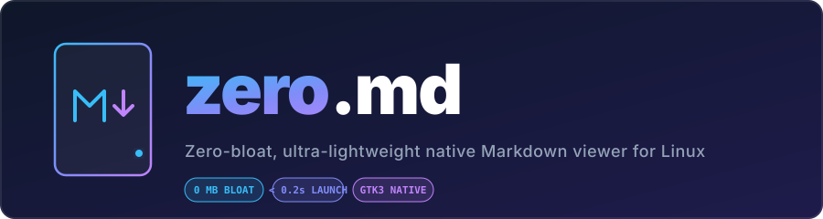

<div align="center">



<br/>

```
    ███████╗███████╗██████╗  ██████╗         ███╗   ███╗██████╗ 
    ╚══███╔╝██╔════╝██╔══██╗██╔═══██╗        ████╗ ████║██╔══██╗
      ███╔╝ █████╗  ██████╔╝██║   ██║        ██╔████╔██║██║  ██║
     ███╔╝  ██╔══╝  ██╔══██╗██║   ██║  ██╗   ██║╚██╔╝██║██║  ██║
    ███████╗███████╗██║  ██║╚██████╔╝  ╚═╝██╗██║ ╚═╝ ██║██████╔╝
    ╚══════╝╚══════╝╚═╝  ╚═╝ ╚═════╝      ╚═╝╚═╝     ╚═╝╚═════╝ 
                 Zero-bloat native Markdown viewer
```

[](https://opensource.org/licenses/MIT)
[](#requirements)
[](https://www.python.org/)
[](#why-zeromd)

*Stop waiting 5 seconds or downloading 300 MB just to read a README.*

[Quick Install](#-quick-install) • [Features](#-features) • [Shortcuts](#-shortcuts) • [Uninstall](#-uninstall)

</div>

---

> [!NOTE]
> **Linux Only:** `zero.md` is handcrafted specifically for the Linux desktop ecosystem (GNOME, XFCE, MATE, Cinnamon, etc.) using native GTK3 & WebKit2 engines.

---

## ⚡ Quick Install

Copy and paste this single command into your Linux terminal:

```bash
curl -fsSL https://raw.githubusercontent.com/amrimangunsong/zero.md/main/install.sh | bash
```

**That's it!** No `sudo` required. You can now immediately **double-click any `.md` file** in your file manager (Nautilus/Files, Thunar, Nemo) or run:

```bash
zero.md README.md
```

---

## 💡 Why zero.md?

Most existing Markdown viewers on desktop require enormous runtimes:
- **ReText**: Pulls ~330 MB of Qt6 & QtWebEngine (Chromium).
- **Apostrophe**: Pulls ~200 MB of Pandoc & Haskell compiler dependencies.
- **Electron viewers**: Consume 150 MB+ RAM just to display text.

**`zero.md` takes 0 MB extra download** by reusing the high-performance GTK & WebKit libraries already shipped with modern Linux distributions.

| Feature | `zero.md` | ReText | Apostrophe | VS Code / IDE |
| :--- | :---: | :---: | :---: | :---: |
| **Download Bloat** | **0 MB** | 334 MB | 203 MB | 1 GB+ |
| **Startup Time** | **< 0.2s** | 2.5s | 1.8s | 3.5s+ |
| **Double-Click Open** | ✅ | ✅ | ✅ | ✅ |
| **Auto Dark/Light Theme** | ✅ | ❌ | ✅ | ✅ |
| **Print / PDF Export** | ✅ | ✅ | ❌ | Plugin |
| **Sudo Required** | ❌ No | ✅ Yes | ✅ Yes | N/A |

---

## ✨ Features

- 🖱️ **Seamless Double-Click**: Integrated with Linux MIME system (`xdg-mime`). Double-click `.md` files to open instantly.
- 🌓 **Automatic Dark / Light Mode**: Detects your desktop's color scheme and renders GitHub-style light or dark typography accordingly.
- 🎨 **Code Syntax Highlighting**: Automatic highlighting for Python, JavaScript, Bash, Rust, Go, C++, JSON, and 300+ languages via Pygments.
- 🖨️ **Print & Export to PDF**: Press `Ctrl + P` to export any Markdown file to PDF or print directly via the native Linux print dialog.
- 🖼️ **Local Image Support**: Relative image paths (``) render automatically.
- ⌨️ **Keyboard-Driven**: Fast zoom, reload, and navigation shortcuts.

---

## ⌨️ Shortcuts

| Shortcut | Action |
| :--- | :--- |
| `Ctrl + O` | Open another Markdown file |
| `Ctrl + R` / `F5` | Reload current file |
| `Ctrl + P` | Print / Export to PDF |
| `Ctrl + +` / `Ctrl + =` | Zoom in |
| `Ctrl + -` | Zoom out |
| `Ctrl + 0` | Reset zoom to 100% |
| `Esc` / `Ctrl + W` / `Ctrl + Q` | Close window |

---

## 📦 Requirements

`zero.md` uses libraries typically pre-installed on Linux distributions with GTK environments (Ubuntu, Debian, Fedora, Mint, Pop!_OS, Arch):

- **Python 3**
- **GTK 3** & **WebKit2GTK** (`gir1.2-webkit2-4.1`)
- **python3-markdown-it** & **python3-pygments**

If you are on a minimal distro, install with your package manager:
```bash
# Ubuntu / Debian / Pop!_OS
sudo apt install python3-gi gir1.2-webkit2-4.1 python3-markdown-it python3-pygments

# Fedora
sudo dnf install python3-gobject webkit2gtk4.1 python3-markdown-it python3-pygments

# Arch Linux
sudo pacman -S python-gobject webkit2gtk-4.1 python-markdown-it python-pygments
```

---

## 🗑️ Uninstall

If you ever wish to remove `zero.md`, run:

```bash
curl -fsSL https://raw.githubusercontent.com/amrimangunsong/zero.md/main/uninstall.sh | bash
```

---

## 📄 License

[MIT License](LICENSE) © 2026 [Amri Maslihan Mangunsong](https://github.com/amrimangunsong)
